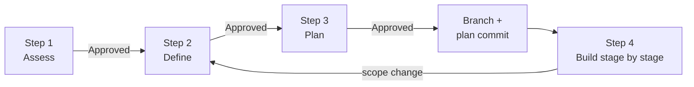

# Railspike


**Make your coding agent write the plan down first.**

Railspike is a set of Markdown instructions your agent follows. The agent writes requirements and a staged plan into your repo, then stops until you approve each one. After that it builds on a branch, with one commit per stage.

It works with Claude Code, Codex, GitHub Copilot, and any other agent that can read files in your project. There's nothing to install beyond the files themselves: no CLI, no dependencies.

[Website](https://gulkily.github.io/railspike/) · [RAILSPIKE.md](RAILSPIKE.md) · [Step files](docs/workflow/)

## Why I built this

I wanted plans that live in the repo, that I can edit in my own editor and come back to the next day, with explicit review points when the direction changes.

So Railspike puts every plan in a Markdown file. You can read it in VS Code, Obsidian, vim, or a GitHub diff. You can edit it directly or ask the agent to change it. The instructions require the agent to stop until you type `Approved Step N`. These are instructions the agent follows, not a technical enforcement mechanism.

## Quick start

### 1. Add Railspike

From the root of a clean Git working tree, add Railspike as a submodule. The path `docs/railspike` must be unused, and neither it nor `docs` may be a symlink.

```bash
git submodule add https://github.com/gulkily/railspike.git docs/railspike
```

A submodule pins the instructions to a revision and lets you review upstream updates. Review and commit `.gitmodules` and the submodule pointer. See the [installation checks](#installation-checks) for the exact preflight and review commands, and [Reusing across projects](#reusing-across-projects) for initialization and updates.

### 2. Give your agent a task

```text
I want to export my saved searches as CSV. Write Step 1 of @railspike.
```

If your agent doesn't autocomplete `@railspike`, select `RAILSPIKE.md` if offered, or give it `docs/railspike/RAILSPIKE.md` directly. For a change with an obvious approach, start at Step 2.

### 3. Review and approve

Open the file the agent wrote in `docs/plans/`. Edit it, or ask for changes:

```text
Use option A's export flow with option B's privacy checks.
Leave scheduled exports out of scope.
```

Ask the agent to recheck the combined approach’s tradeoffs and update the recommendation. When it says what you want, reply:

```text
Approved Step 1
```

Repeat for each step. Don't approve a file you haven't read.

## The four steps

| Step | The agent writes | You decide |
|---|---|---|
| 1. Assess (optional) | Up to four approaches with tradeoffs and a recommendation | Which approach, or which parts of two to combine |
| 2. Define | Problem, user stories, requirements, out of scope, risks, success criteria | What "done" means |
| 3. Plan | Numbered stages with dependencies and how each one gets verified | Whether the stages are small and in the right order |
| 4. Build | Code, docs, tests, or checklists, one stage at a time, plus a running summary | Whether the result matches the plan |

Each Step 1–3 plan file should fit on one page. If it doesn't, the scope is probably too big.

### How commits work

The plan files stay uncommitted while you revise them. When you type `Approved Step 3`, the agent creates a feature branch. The first commit contains only the approved plans. Then each stage gets its own commit, together with its section of the Step 4 summary. So a three-stage plan ends with at least four commits.

### When scope changes

If something new comes up during Step 4, the agent stops and goes back to Step 2. You review and approve the revised scope and plan before building continues.



## When to use it

Use it when a change touches more than a few files, when there's a real choice between approaches, or when the work will run across more than one session. A reviewed plan is useful on its own, even if you build it later or hand it to someone else.

For a one-line fix it's overkill.

Use it for planning, documentation, development, bug fixes, test suites, and checklists. For documentation-only work, Step 2 lists which files may change and Step 3 retains that boundary. Verification covers document integrity, evidence, links, and allowed file scope; runtime checks apply only when the document makes claims that need them.

## Tips

- **Make the agent reprint the step file** before it starts each step. You'll both be working from the same instructions, and you'll see right away if it skipped one.
- **Ask about existing components in Step 2.** Agents drift fastest when they rebuild something that already exists.
- **Keep Step 4 to the plan.** New ideas go back to Step 2. That's the point of the gates.
- **Split anything over eight stages** into a second Step 2/3 cycle.

## What's in this repo

```text
RAILSPIKE.md          The entry point. The agent reads this first.
docs/workflow/        One instruction file per step (Steps 3 and 4 have before/do/after phases).
docs/failure-modes.md What to do when a run goes wrong.
```

See the [failure-mode guide](./docs/failure-modes.md) for recovery and the [maintainer backlog](./BACKLOG.md) for project follow-up.

Your plans go in your project's `docs/plans/`, not here. The agent opens only the step file it needs, so it never has to hold one huge prompt in context.

## Customizing

Every instruction is plain Markdown. To add a checklist for your domain, copy a step file, edit it, and point your agent at your copy. Mockups, diagrams, and research notes can go next to the plans in `docs/plans/{feature}/`.

## Installation checks

From the **root of a clean, non-bare Git working tree**, run these read-only checks first. Stop if a check does not have the stated result; do not clean, reset, stash, remove, or overwrite anything to make it pass.

```bash
# Both commands must print the same absolute path.
git rev-parse --show-toplevel
pwd -P

# Must print "false".
git rev-parse --is-bare-repository

# Must print nothing. This includes staged, unstaged, and untracked files.
git status --porcelain --untracked-files=all --ignore-submodules=none

# Must exit successfully; docs/railspike must not exist, including as a symlink.
test ! -L docs
test ! -e docs/railspike && test ! -L docs/railspike
```

When all checks pass, add Railspike. This command writes `.gitmodules`, stages the new submodule entry, and creates `docs/railspike`; it does not create a commit.

```bash
git submodule add https://github.com/gulkily/railspike.git docs/railspike
git status --short
git diff --cached -- .gitmodules docs/railspike
```

Inspect the displayed changes, then commit them through your normal repository workflow. Do not continue if the output shows files beyond `.gitmodules` and `docs/railspike`.

## Reusing across projects

When cloning a project that already includes Railspike, either clone with `--recurse-submodules` or initialize just Railspike afterward:

```bash
git submodule update --init -- docs/railspike
```

This checks out the revision recorded by the host project, often in detached HEAD state. It does not update to the latest upstream revision.

### Ask your agent to update Railspike

> Update Railspike at `docs/railspike` using the Git workflow in its README. Stop if the host or submodule has unreviewed changes or unexpected configuration. Fast-forward only. Outline the upstream changes, old and new revisions, and any required actions; show me the host-project diff. Then offer to commit only the submodule-pointer change or leave it uncommitted for review. Do not commit until I choose.

The agent should read this procedure before updating. From the **host repository root**, the following guarded commands check the installation and fetch `master`. A clean detached checkout from clone initialization is supported, as is a clean `master` checkout. Run the entire block, stopping on any error:

<!-- railspike-update-start -->
```bash
(
set -eu
stop() { printf '%s\n' "$*" >&2; exit 1; }
expected_url=https://github.com/gulkily/railspike.git
[ "$(git rev-parse --is-bare-repository)" = false ] || stop 'Use a non-bare host repository.'
[ "$(git rev-parse --show-toplevel)" = "$(pwd -P)" ] || stop 'Start at the host repository root.'
[ -z "$(git status --porcelain --untracked-files=all --ignore-submodules=none)" ] || stop 'Review host changes before updating.'
[ ! -L docs ] && [ ! -L docs/railspike ] || stop 'Refusing a symlinked installation path.'
[ "$(git ls-files -s -- docs/railspike | cut -d ' ' -f 1)" = 160000 ] || stop 'Expected a registered Railspike submodule.'
[ "$(git config --file .gitmodules --get submodule.docs/railspike.path)" = docs/railspike ] || stop 'Unexpected submodule path.'
[ "$(git config --file .gitmodules --get submodule.docs/railspike.url)" = "$expected_url" ] || stop 'Unexpected registered URL.'
[ -f docs/railspike/.git ] || stop 'Initialize Railspike with git submodule update --init -- docs/railspike first.'
[ "$(git -C docs/railspike rev-parse --show-toplevel)" = "$(pwd -P)/docs/railspike" ] || stop 'Unexpected submodule checkout.'
[ -z "$(git -C docs/railspike status --porcelain --untracked-files=all --ignore-submodules=none)" ] || stop 'Review submodule changes before updating.'
[ "$(git -C docs/railspike remote get-url origin)" = "$expected_url" ] || stop 'Unexpected submodule origin.'
for configured_branch in "$(git config --file .gitmodules --get submodule.docs/railspike.branch || :)" "$(git config --local --get submodule.docs/railspike.branch || :)"; do
  case "$configured_branch" in ''|master) ;; *) stop 'Unexpected update branch.' ;; esac
done
case "$(git -C docs/railspike branch --show-current)" in
  ''|master) ;; *) stop 'Expected master or a detached checkout.' ;;
esac
old_revision=$(git -C docs/railspike rev-parse HEAD)
git -C docs/railspike fetch origin master
git -C docs/railspike merge-base --is-ancestor "$old_revision" FETCH_HEAD || stop 'Upstream diverged or local commits are ahead; inspect history.'
git -C docs/railspike -c merge.autostash=false merge --ff-only FETCH_HEAD
new_revision=$(git -C docs/railspike rev-parse HEAD)
printf 'Railspike: %s -> %s\n' "$old_revision" "$new_revision"
git -C docs/railspike log --oneline "$old_revision..$new_revision"
git diff --submodule=log -- docs/railspike
git status --short
)
```
<!-- railspike-update-end -->

After a successful update, summarize the relevant upstream changes and required actions, inspecting the upstream diff as needed. If the revision changed, offer **commit the pointer update** or **leave it uncommitted for review**. On approval, recheck that only `docs/railspike` changed, stage that path alone, and commit it. An already-current installation needs no commit.

If a check fails, stop and explain it. Do not reset, clean, stash, delete files, change remotes, or force an update to make a check pass. Fetch can change remote-tracking metadata even when an update is refused. If a network operation or update is interrupted, inspect the current checkout and host diff before retrying; do not assume rollback.

## Documentation checks

Run these before sharing a Railspike change. The link check validates local Markdown paths; review rendered Mermaid diagrams on GitHub after publication because GitHub owns the renderer.

The Markdown-link checker is available in Python, Perl, and Node.js so it can run in installation environments with different runtimes available. Choose whichever version fits your environment; installing all three runtimes is not required. We intentionally maintain these language alternatives with equivalent behavior and no third-party dependencies. When changing the checker itself, verify all three implementations.

```bash
# Choose one Markdown-link checker:
# Python 2.7+ or Python 3
python scripts/check-markdown-links.py

# Perl (core modules only)
perl scripts/check-markdown-links.pl

# Node.js
node scripts/check-markdown-links.mjs

# Then run the Git workflow and whitespace checks:
bash scripts/check-railspike-git-workflow.sh
git diff --check
git status --short
```

## Contributing

See [CONTRIBUTING.md](CONTRIBUTING.md) for the link checker and workflow tests. Bugs and ideas go in [Issues](https://github.com/gulkily/railspike/issues).

## License

[MIT](LICENSE)
